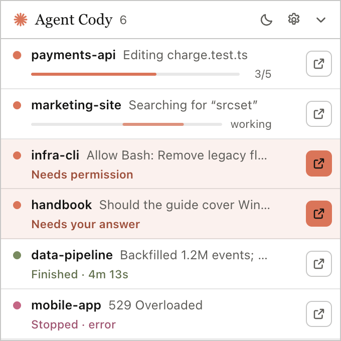
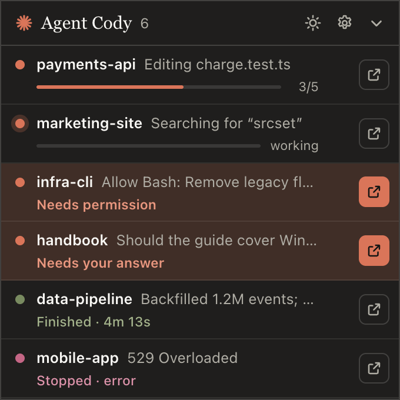

# Agent Cody

**A small widget that shows what all your Claude Code agents are doing, and taps you on the shoulder when one needs you.**

<p>
  
  &nbsp;
  
</p>

> A hobby project made for friends. Free to use, no warranty. 🙂

## What it does

- 👀 Shows a live list of every Claude Code session running on your computer.
- 📊 Progress bars show how far each agent is (for example "3/5" steps done).
- 🔔 Sends a notification when an agent needs your permission, asks you something, or stops.
- 📱 Can send the same alerts to your phone through Telegram, so you know even when you've walked away.
- 🪟 Click **Open** to jump straight back to that agent's window.
- 🌗 Light and dark mode, or follows your computer's setting.

## Download

Get the latest version from the **[Releases page](https://github.com/kolb-manu/Agent-Cody/releases)**. Pick the file for your computer:

| Your computer | Download this file |
| --- | --- |
| Mac with Apple Silicon (M1, M2, M3, M4…) | `Agent-Cody-…-mac-arm64.dmg` |
| Mac with an Intel chip | `Agent-Cody-…-mac-x64.dmg` |
| Windows 10 or 11 | `Agent-Cody-…-win-x64.exe` |

Not sure which Mac you have? Click the Apple menu (top left) → **About This Mac**. If it says "Chip: Apple M…", it's Apple Silicon. If it says "Processor: Intel", it's Intel.

## Install

The app isn't "signed" (registered with Apple or Microsoft, which costs money every year). So the first time you open it, your computer warns you. That's expected. Here's how to get past it:

### Mac

1. Open the `.dmg` file you downloaded.
2. Drag **Agent Cody** into the **Applications** folder.
3. Open **Applications** and double-click **Agent Cody**. You'll see a warning that it can't be opened. Click **Done**.
4. Open **System Settings → Privacy & Security**, scroll down, and click **Open Anyway** next to "Agent Cody". Confirm with your password, then click **Open**.

You only do this once. On older Macs (macOS 14 or earlier) there's a shortcut: **right-click** the app → **Open** → **Open**.

### Windows

1. Double-click `Agent-Cody-…-win-x64.exe`.
2. If you see "Windows protected your PC", click **More info**, then **Run anyway**.
3. It installs by itself in a few seconds (no admin password needed) and opens Agent Cody.

## First-time setup

1. **Open Agent Cody.** It asks if it should start automatically when you log in. Your choice, and you can change it later.
2. **Click "Install hooks".** Hooks are small connectors that let Claude Code tell the widget what it's doing. Agent Cody makes a backup of Claude Code's settings file first, and leaves anything else in it alone.
3. **Restart any Claude Code sessions that were already open.** New sessions show up in the widget automatically.

## Updating

From version 0.2.0 on, Agent Cody looks for new versions by itself (you can turn this off in **Settings → Updates**).

- **Windows** updates itself. When a new version is downloaded, the widget says **Restart to update**. Click it, or just carry on: it updates the next time you quit Agent Cody.
- **Mac** tells you when there's a new version. Click **Download** in the widget, open the downloaded `.dmg`, quit Agent Cody (menu-bar icon → **Quit Agent Cody**), then drag the new **Agent Cody** into **Applications** and choose **Replace**. Your settings and hooks are kept. If macOS warns you again, allow it the same way as the first time (see [Install](#install)).

If you're on 0.1.0, install 0.2.0 by hand once. After that, the app tells you about new versions.

## Using it

Each row is one agent. The coloured dot tells you how it's doing:

| Dot | Meaning |
| --- | --- |
| 🟠 pulsing | **Working.** The bar shows its progress. |
| 🟠 orange row | **Needs you.** It wants permission or asked a question. |
| 🟢 green | **Finished**, with how long it took. |
| 🩷 pink | **Stopped**, for example because of an error. |

- **Open** (the arrow button on each row) brings you back to that agent's terminal or code editor window.
- **Minimise:** click the ⌄ arrow at the top to shrink the widget into a small pill. Click the pill to make it big again. It turns orange when an agent needs you.
- **Hide or bring it back:** use the Agent Cody icon in the menu bar (Mac, top right of the screen) or the system tray (Windows, next to the clock; it may be hidden under the **^** arrow).
- **Theme:** the moon/sun button switches light and dark. In **Settings** (gear icon) you can pick **System** to follow your computer.
- **Start at login:** turn it on or off any time in **Settings**.
- **Size:** the widget grows and shrinks to fit your agents. Drag the sides to change the width. To size it by hand instead, turn off **Settings → Resize to fit agents**.

## Telegram alerts

Get your alerts on your phone, so you know when an agent needs you even if you're away from the computer.

1. Open **Settings** (gear icon) and click **Connect Telegram**.
2. Telegram opens the **@agentcodyalertsbot** chat. Tap **Start**.
3. That's it. A few seconds later Agent Cody says *Connected as @yourname*, and the bot sends you a confirmation.

You only get alerts from your own computer. They follow the same switches as the desktop notifications (needs permission, stops, finishes). Under **Settings → Telegram** you can also:

- **Only when I’m away**: send to Telegram only if you haven't touched the computer for 2 minutes. Alerts that come in while you're at your desk aren't sent later.
- **Include Claude’s last message**: turn it off to get just the project name and status.
- **Send test message**, or **Disconnect**.

Alerts go through Telegram’s servers. They include the project folder name and, if you allow it, a preview of Claude’s last message. If you block the bot, Settings shows *Telegram disconnected* and you can **Reconnect** any time. Didn't work? Click **Enter chat ID instead** and type your chat ID (ask the friend who set up the bot how to find it).

## Good to know

- **It needs Node.js.** Node.js is a free program that the hooks use to run. If you don't have it, download the "LTS" version from [nodejs.org](https://nodejs.org) and install it like any other app.
- **It only works with Claude Code** (in the terminal or your code editor), not with the normal Claude chat or Cowork.
- **Progress bars only fill up when Claude makes a to-do list.** Otherwise you see a gentle moving bar and the word "working".
- **Everything stays on your computer** unless you connect Telegram. No account, and it uses none of your Claude usage. Otherwise the only thing it asks the internet is whether there's a new version (on GitHub).

## Troubleshooting

**The widget stays empty.**
- Check that the hooks are installed: **Settings → Claude Code hooks** should say *Installed*. If not, click **Install**.
- Sessions that were already open before you installed the hooks don't show up. Restart them.
- Make sure Node.js is installed (see above).

**I don't get notifications.**
- Mac: **System Settings → Notifications → Agent Cody** → allow notifications.
- Windows: **Settings → System → Notifications** → make sure Agent Cody is on.
- Also check **Settings** inside Agent Cody, where you choose which events notify you.

**The Mac says the app "is damaged" or there's no "Open Anyway" button.**
- Try opening the app again: the **Open Anyway** button only shows up for a while after a blocked attempt.
- If that doesn't help, open the **Terminal** app, paste this line and press Enter. It removes the "downloaded from the internet" flag:
  `xattr -cr "/Applications/Agent Cody.app"`

**How do I remove the hooks?**
Open **Settings → Claude Code hooks → Uninstall** (or use the menu-bar/tray icon → *Uninstall Claude Code hooks*). Only Agent Cody's own entries are removed, and a backup is made first.

## Known limitations

- **"Start when I log in" may not stick on a Mac.** Because the app isn't signed, macOS sometimes ignores the request. If Agent Cody doesn't open after you restart, add it by hand: **System Settings → General → Login Items** → click **+** under "Open at Login" → choose **Agent Cody** in Applications.
- **First launch shows a warning** on both Mac and Windows, because the app isn't signed. See [Install](#install): on a Mac use **Open Anyway** (or right-click → **Open** on macOS 14 and older), on Windows **More info** → **Run anyway**.
- Windows is less tested than Mac. If something doesn't work there, please let me know.
- **Open** works best with Mac's Terminal and iTerm2 (it finds the exact tab). For other apps it brings the app to the front, and you pick the tab.

## Problems or ideas?

Open an issue on **[GitHub Issues](https://github.com/kolb-manu/Agent-Cody/issues)** and describe what happened. A screenshot helps.

---

## For developers

Everything below is for people who want to build, test or change Agent Cody.

### Requirements

- Node.js 18+ (for development, and on PATH for the hook. See [Known limitations](#technical-limitations)).
- Claude Code with hooks support.

### Install and run (development)

```bash
npm install
npm start
```

The widget appears in the top-right corner, and an icon appears in the menu bar (macOS) or system tray (Windows).

### See it working without real agents

With the app running, in a second terminal:

```bash
npm run simulate:showcase # every state at once, alternating light/dark previews
npm run simulate          # ~45s of fake activity for 4 sessions
npm run simulate -- --fast
npm run simulate:hook     # same, but every event goes through the real hook script
```

The showcase puts six agents on screen: working with a 3/5 plan, working without a to-do list (sweeping bar), needs permission, asks a question, finished (`Finished · 4m 12s`), and stopped (`Stopped · error`). It previews the light and dark themes twice (`--cycles=N`, `--hold=ms`), then returns to your saved theme. The preview doesn't change your setting.

The simulation includes TodoWrite progress, Task-tool progress, subagents, a permission request (approved after ~10s), a question, a finished turn, an API error, and a session that ends and fades out. You get native notifications for the permission request, the question, the finishes and the error.

### First run (details)

The first time the **installed** app starts, a small card inside the widget asks:

1. **"Start Agent Cody automatically when you log in?"** Yes / Not now. It asks only once. From then on, the choice lives in Settings.
2. **"Connect Claude Code?"** Install hooks / Not now. This only appears if the hooks aren't installed yet, and installs them with the same safe merge described below.

Nothing is turned on silently. If you never answer Yes, Agent Cody doesn't start at login. When running from source (`npm start`) the card doesn't appear. Set `AGENT_CODY_FORCE_ONBOARDING=1` to preview it.

### Install the Claude Code hooks

Pick one:

- Click **Install Claude Code hooks** in the widget, which appears when no hooks are installed.
- Use the tray menu: **Install Claude Code hooks…**
- From the terminal: `npm run hooks:install` (`hooks:status`, `hooks:uninstall`)

What the installer does:

1. Copies `hook/agent-cody-hook.js` to `~/.agent-cody/agent-cody-hook.js`, a stable location outside the app bundle.
2. Backs up `~/.claude/settings.json` to `settings.json.agent-cody-backup-<timestamp>`.
3. Appends one entry per event and never modifies or removes your existing hooks. Reinstalling replaces only Agent Cody's own entries. If `settings.json` isn't valid JSON, it refuses and changes nothing.

Each added entry looks like this. It runs in exec form, with no shell, so it behaves the same on macOS and Windows:

```json
{
  "hooks": {
    "PreToolUse": [
      { "hooks": [{ "type": "command", "command": "/usr/local/bin/node",
                    "args": ["/Users/you/.agent-cody/agent-cody-hook.js", "--exec"], "async": true }] }
    ]
  }
}
```

Events used: `SessionStart`, `UserPromptSubmit`, `PreToolUse`, `PermissionRequest`, `PostToolUse`, `PostToolUseFailure`, `Notification`, `Stop`, `StopFailure`, `SubagentStart`, `SubagentStop`, `TaskCreated`, `TaskCompleted`, `SessionEnd`.

All events except `SessionEnd` are `async: true`, so Claude Code never waits for them. `SessionEnd` runs synchronously with a 3s timeout, because async hooks may be killed while Claude exits. The script caps itself at 1.5s, exits 0 silently, and fails fast (connection refused) when the app isn't running.

New Claude Code sessions pick up the hooks. If an already-running session doesn't show up, restart it.

**Uninstall:** use the tray menu, or run `npm run hooks:uninstall`. This removes only entries containing `agent-cody-hook` and makes a backup first. You can also delete `~/.agent-cody/`.

### Using it (details)

| Action | Result |
| --- | --- |
| **Open** button, or click a row | Marks the row as handled and brings that session's terminal or editor window to the front (see [Open](#open-behaviour)) |
| Hover a row → × | Dismiss the row (it comes back if that session gets a new prompt) |
| Moon / sun | Switch between light and dark. This saves an explicit choice; pick **System** in Settings to follow the OS again |
| Gear | Settings (back arrow or Esc returns to the list) |
| Chevron | Minimise to the pill. Click the pill to expand. Drag it by its dotted grip |
| Pill's **Open** | Opens the agent that needs you |
| Click a notification | Opens that agent's window, like Open. If that isn't possible, the widget appears with a hint |
| Tray icon | Show/hide, minimise, settings, sound, hooks, quit |

Row states:

| Dot | Second line | Meaning |
| --- | --- | --- |
| Orange, pulsing | step bar + `3/5`, or sweeping bar + `working` | Working (sweep = no to-do list) |
| Orange, tinted row | `Needs permission` / `Needs your answer` | Waiting for you |
| Green | `Finished · 4m 12s` | Turn finished (time since your prompt) |
| Pink | `Stopped · error` / `interrupted` / `no updates` / `exited` / `ended` | API error, Esc mid-tool, silent for `staleMinutes`, process vanished, or session ended mid-work |
| Hollow | `Ready` | Session open, no prompt yet |

#### Settings

| Setting | Default |
| --- | --- |
| Theme: Light / Dark / System (System follows macOS/Windows, live) | System |
| Notify when an agent needs permission or asks a question | On |
| Notify when an agent stops or errors | On |
| Notify when an agent finishes | Off |
| Play a sound | On |
| Keep on top of other windows | On |
| Resize to fit agents (height follows the list, up to the bottom of the screen; width stays yours) | On |
| Start when I log in | Off, unless you said Yes on first launch |
| Updates: Check automatically (10 s after start, then every 6 hours) | On |
| Telegram: Send alerts to Telegram (once connected) | On |
| Telegram: Only when I’m away (idle 2+ minutes) | Off |
| Telegram: Include Claude’s last message | On |

All settings persist between launches.

**Start when I log in** always shows the real system state: the switch is re-read from macOS or Windows every time Settings opens. If you remove Agent Cody in macOS **System Settings › General › Login Items** or Windows **Settings › Apps › Startup** (or Task Manager), the switch shows off. Turning it on registers the login item; turning it off removes it. A link under the switch opens the system page. In dev mode the switch is disabled with the note "Only works in the installed app".

When started automatically at login, Agent Cody starts quietly. It never takes focus and comes back exactly as you left it: expanded, minimised to the pill, or hidden in the tray. When you start it yourself, it opens normally. Only one copy ever runs, so starting it again just brings the widget forward.

How it works: `src/main/login-item.js` wraps Electron's `app.setLoginItemSettings` / `getLoginItemSettings`.
- **macOS:** registers through SMAppService and uses `status` and `wasOpenedAtLogin`.
- **Windows:** writes a per-user Run entry (no admin) for the installed exe with a `--login` argument, which is how a login start is detected. It uses `executableWillLaunchAtLogin` so entries you disabled show as off. If the entry points at an old exe path, it's re-pointed on startup. The Settings panel also shows hook status, with Install/Reinstall/Uninstall buttons.

#### Open behaviour

Best effort, and it never fails silently:

1. **macOS, Terminal.app and iTerm2:** focuses the exact tab, by matching the tty of the session's Claude process. The first time, macOS asks whether Agent Cody may control Terminal/iTerm2. If you decline, it falls back to step 3.
2. **macOS, VS Code / Cursor / Windsurf / VSCodium / Zed:** opens the project folder in that editor, which brings its window to the front. If the folder isn't open in a window yet, a new one opens.
3. **macOS, other apps** (Warp, Ghostty, WezTerm, JetBrains…): activates the app and shows the hint "look for the *project* tab".
4. **Windows:** walks up from the Claude process to its first ancestor with a window and activates it. Windows may only flash the taskbar button.
5. **If none of that works:** opens the project folder in Finder/Explorer and says so. If the folder doesn't exist either, it shows a hint with the path.

### Configuration

Settings live in `settings.json` in the app's data folder (tray → **Open settings folder**):

- macOS: `~/Library/Application Support/Agent Cody/settings.json`
- Windows: `%APPDATA%\Agent Cody\settings.json`

```json
{
  "port": 47821,
  "theme": "system",
  "notify": { "attention": true, "stopped": true, "finished": false },
  "sound": true,
  "alwaysOnTop": true,
  "openAtLogin": true,
  "staleMinutes": 10,
  "fadeSeconds": 8,
  "checkUpdates": true,
  "telegram": { "chatId": null, "name": null, "enabled": true, "onlyWhenAway": false, "includePreview": true, "disconnected": false }
}
```

Most of these can be changed in the Settings panel. Edit `port`, `staleMinutes` and `fadeSeconds` in the file while the app is closed. Settings files from 0.1 (`muted`, `notifyOn`) are migrated automatically. Window position, size and minimised state carry over. On start, the app writes the port to `~/.agent-cody/config.json`, and the hook reads it from there, so you don't need to reinstall hooks after changing the port. `AGENT_CODY_PORT=<n>` overrides the port temporarily for both the app and the simulator, without touching the hook config. `AGENT_CODY_USER_DATA=<dir>` uses a separate profile, which is handy for testing.

### Build installers

Releases are built and published automatically by GitHub Actions when you push a version tag. See **[RELEASING.md](RELEASING.md)**. The commands below are for local builds.

```bash
npm run icons      # rebuilds the app icons from build/logo/agent-cody-ping.png (needs Python + Pillow; already committed)
npm run dist:mac   # → dist/Agent-Cody-<version>-mac-arm64.dmg and dist/Agent-Cody-<version>-mac-x64.dmg
npm run dist:win   # → dist/Agent-Cody-<version>-win-x64.exe (per-user installer)
npm run pack       # unpacked app for the current OS, for quick testing
```

- **macOS:** builds are *ad-hoc* signed (`"identity": "-"`, free, no certificate). This keeps the bundle valid, so downloads show the normal "unidentified developer" prompt rather than "app is damaged". For real signing, see RELEASING.md. Unsigned apps need **System Settings → Privacy & Security → Open Anyway** on first launch (macOS 15+), or right-click → **Open** on older versions. `dist:mac` builds both Apple Silicon and Intel.
- **Windows:** the NSIS installer installs per user (`%LOCALAPPDATA%\Programs\agent-cody`, no admin rights). Updates install to the same folder, so the start-at-login entry keeps working. The installer can also be built from macOS (tested). Without a code-signing certificate, SmartScreen warns on first run.

### How it works

```
Claude Code ──hook (stdin JSON)──▶ node ~/.agent-cody/agent-cody-hook.js
                                        │ keeps ~20 small fields (no file contents, no transcripts)
                                        ▼
                              POST http://127.0.0.1:47821/event  (header X-Agent-Cody: 1)
                                        ▼
                     Electron main: SessionStore (state per session_id) ──▶ widget, tray, notifications
```

- `hook/agent-cody-hook.js`: dependency-free hook script.
- `src/main/sessions.js`: pure event → state reducer (unit-tested). Handles staleness, dead processes and fade-out.
- `src/main/server.js`: localhost-only receiver. It requires a custom header, so web pages can't post events.
- `src/main/hooks-installer.js`: safe merge into, and removal from, `~/.claude/settings.json`.
- `src/main/focus.js`: best-effort window focusing (tty matching, editor folders, app activation).
- `src/main/settings.js`: persisted settings with validation and migration.
- `src/main/telegram.js`: Telegram alerts (connect flow, message text, Bot API calls and retries), pure with an injected `fetch` and unit-tested. Run with `AGENT_CODY_TELEGRAM_TOKEN=<token> npm start`; see [RELEASING.md](RELEASING.md#telegram-alerts).
- `src/main/update-check.js`: macOS update check (version comparison, picking the DMG), pure and unit-tested. Windows uses `electron-updater`.
- `src/main/main.js`: window, tray, IPC and notifications wiring. `src/renderer/`: the UI.

Run the tests with `npm test`. They cover the reducer (states, turn timing, stop reasons), settings defaults and migration, installer safety (preserving hooks, idempotency, invalid JSON, uninstall restoring the original file), and the hook script (exits fast with no app running, drops file contents).

### Privacy

Everything stays on your machine. The hook sends only the session id, project path, event name, tool name, short descriptions (file name, command or description, search pattern, truncated prompt or last message), to-do statuses, and terminal identification for the Open button. It never sends file contents, diffs or transcripts. The only outbound request is the update check: on macOS a GET to `api.github.com/repos/kolb-manu/Agent-Cody/releases/latest`, on Windows electron-updater reading `latest.yml` from the GitHub Release (and downloading the installer). No session data is sent, and it can be turned off in Settings. If you connect Telegram, alerts (title, status and, if allowed, the notification text with the project folder name) are sent to `api.telegram.org`, only to your own chat; while the Connect flow runs the app also reads the bot's pending messages to find your `/start`. Running from source never checks unless `AGENT_CODY_FORCE_UPDATE_CHECK=1` is set. See [RELEASING.md](RELEASING.md#in-app-updates).

### Technical limitations

- **Open is best effort** (see [Open behaviour](#open-behaviour)).
  - Exact-tab focus only works for Terminal.app and iTerm2, and only for sessions started after the hooks were installed (it needs the Claude process id).
  - The iTerm2 script couldn't be checked on the build machine, because iTerm2 isn't installed there.
  - Windows Terminal tabs can't be targeted individually.
- **Progress bars need a plan.** They come from `TodoWrite` or the Task tools (`TaskCreate`/`TaskUpdate`, plus the `TaskCreated`/`TaskCompleted` events). Claude Code only enables those tools by default on some models (see "Task tool availability" in the Claude Code tools reference). Sessions without a plan show a sweeping bar and `working` instead of a step count.
- **The hook needs Node.js.** The installer records the absolute path to `node`. For version managers (nvm, fnm, volta, asdf…) it records plain `node`, so it follows your active version. If Node isn't found, the hook fails silently and the widget stays empty.
- **Interrupts:** pressing Esc doesn't fire `Stop`. Agent Cody only sees an interrupt if a tool was running (`PostToolUseFailure` with `is_interrupt`). Otherwise the row shows *working* until the next event, or `Stopped · no updates` after `staleMinutes`.
- **"Needs permission" clears** when Claude continues (the next tool event, prompt or stop) or when you press Open. Pressing Open counts as handled even if you didn't answer in the terminal.
- **Start at login on macOS** needs a signed and notarized app to work reliably (Electron's docs say unsigned builds may silently fail). If macOS reports *requires approval*, the Settings switch says so and links to Login Items. If the system rejects the item, the switch snaps back to off with a message. It never pretends.
- **Start when I log in** only applies to the installed app. Running from source never registers a login item.
- **Theme preview:** the showcase's light/dark preview overrides the display only. Your saved theme is restored when the showcase ends, or when you change the theme.
- **Sessions that started before the app** appear on their next event. Their step progress fills in at the next plan update.
- **Windows notifications** need the installed app (the NSIS installer registers the Start-menu shortcut and AppUserModelID). When running from source, Windows may not show toasts.
- **Untested on real Windows hardware:** the code paths and the Windows build were checked from macOS only.
- Linux isn't a target, though the app mostly works there (no click-to-focus).
